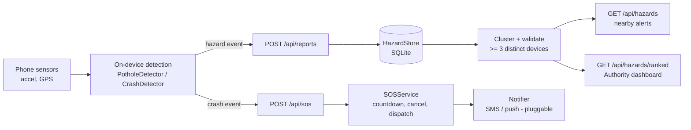

# RakshaPath

**Preventing road crashes and speeding up emergency response with the smartphone already in every driver's pocket.**

Built by **Team SPRINT** for **HackOverflow 10.0** | Theme: **Road Safety**

> **Status: hackathon prototype.** The detection logic is heuristic and has not been calibrated on real vehicles. The SOS module does **not** contact real emergency services. Do not rely on it for safety. See [Limitations](#limitations).

---

## Table of contents
- [The problem](#the-problem)
- [What RakshaPath does](#what-rakshapath-does)
- [Architecture](#architecture)
- [Project structure](#project-structure)
- [Quick start](#quick-start)
- [API reference](#api-reference)
- [How the detection works](#how-the-detection-works)
- [Testing](#testing)
- [Roadmap](#roadmap)
- [Limitations](#limitations)
- [Team and license](#team-and-license)

## The problem
Road crashes are a leading cause of death worldwide, and in India alone they cost well over a lakh of lives each year (see WHO's *Global Status Report on Road Safety 2023* and MoRTH's *Road Accidents in India*). Three gaps keep recurring:

1. **Hazardous roads** - potholes and broken surfaces are reported late, if at all.
2. **Risky driving** - drowsiness and distraction go unnoticed until it is too late.
3. **Slow response** - crash victims often wait for a bystander to raise the alarm.

## What RakshaPath does

| Layer | What it does | In this repo |
|---|---|---|
| **Detect** | Spots potholes from accelerometer shocks while the vehicle is moving | `rakshapath/detection.py` (`PotholeDetector`) |
| **Validate** | Confirms a hazard only after reports from several distinct devices cluster together | `rakshapath/hazards.py` |
| **Warn** | Serves nearby confirmed hazards so the app can give voice alerts | `GET /api/hazards` |
| **Respond** | Detects impact + sudden stop, runs a cancellable countdown, then dispatches an SOS with a location link | `detection.py` (`CrashDetector`), `sos.py` |
| **Fix** | Ranks confirmed hazards by risk for municipal repair prioritisation | `GET /api/hazards/ranked`, `dashboard/` |

**Not yet implemented:** the mobile app (sensor capture, voice alerts), drowsiness/distraction coaching, and real SMS/push delivery. They are on the [roadmap](#roadmap).

## Architecture



Privacy by design: raw sensor streams stay on the phone. Only anonymous event points (`device_id`, lat, lon, severity) are uploaded.

## Project structure

```
rakshapath-road-safety/
├── rakshapath/            # Core library (stdlib only, no dependencies)
│   ├── detection.py       # PotholeDetector, CrashDetector
│   ├── hazards.py         # HazardStore: clustering, validation, ranking
│   └── sos.py             # SOSService: countdown, cancel, dispatch
├── backend/app.py         # FastAPI service
├── dashboard/index.html   # Authority dashboard (Leaflet + OpenStreetMap)
├── scripts/simulate.py    # Synthetic drive: pothole + crash
├── tests/                 # unittest suite (16 tests)
├── requirements.txt
└── LICENSE
```

## Quick start

**Requirements:** Python 3.10+

```bash
git clone https://github.com/<your-username>/rakshapath-road-safety.git
cd rakshapath-road-safety

python -m venv .venv
source .venv/bin/activate        # Windows: .venv\Scripts\activate
pip install -r requirements.txt
```

### 1. Run the detection simulation (no server needed)
```bash
python scripts/simulate.py
```
Expected output (the second pothole line is the crash impact spike, which the pothole detector also sees):
```
pothole  t=5.0s severity=severe dev=13.0 m/s^2
pothole  t=20.0s severity=severe dev=41.2 m/s^2
CRASH    impact t=20.0s peak=5.2g pre-speed=40 km/h -> start SOS countdown
```

### 2. Start the API and dashboard
```bash
uvicorn backend.app:app --reload
```
- Interactive API docs: http://localhost:8000/docs
- Authority dashboard: http://localhost:8000/dashboard/

The dashboard loads map tiles and Leaflet from the internet, so it needs a connection.

### 3. Try it with sample data
Three **different** devices must report the same spot before it counts as a hazard:
```bash
for d in phone-a phone-b phone-c; do
  curl -s -X POST localhost:8000/api/reports -H "Content-Type: application/json" \
    -d "{\"device_id\":\"$d\",\"lat\":17.3850,\"lon\":78.4867,\"severity\":\"severe\"}"
done

curl "localhost:8000/api/hazards?lat=17.3850&lon=78.4867&radius_m=300"
curl "localhost:8000/api/hazards/ranked"
```
Refresh the dashboard to see the hazard on the map.

Test the SOS flow:
```bash
curl -X POST localhost:8000/api/sos -H "Content-Type: application/json" \
  -d '{"device_id":"phone-a","lat":17.385,"lon":78.4867,"contacts":["+910000000000"]}'
# cancel within the countdown:
curl -X DELETE localhost:8000/api/sos/phone-a
# or after 10 s, trigger dispatch (prints to the server console):
curl -X POST localhost:8000/api/sos/tick
```

## API reference

| Method | Endpoint | Description |
|---|---|---|
| `GET` | `/api/health` | Liveness check |
| `POST` | `/api/reports` | Submit a hazard report `{device_id, lat, lon, severity: "minor"\|"severe"}` |
| `GET` | `/api/hazards?lat&lon&radius_m=500` | Confirmed hazards near a point, nearest first |
| `GET` | `/api/hazards/ranked?limit=50` | Confirmed hazards by risk score, for repair prioritisation |
| `POST` | `/api/sos` | Start an SOS countdown `{device_id, lat, lon, contacts[]}` |
| `DELETE` | `/api/sos/{device_id}` | Cancel a pending SOS |
| `POST` | `/api/sos/tick` | Dev helper: dispatch SOSs whose countdown elapsed |

## How the detection works

**Pothole** (`PotholeDetector`): computes `| |a| - g |` from the 3-axis accelerometer. A shock counts when the speed is at least 10 km/h and the deviation reaches 6 m/s² (`minor`) or 10 m/s² (`severe`). A 1.5 s cooldown prevents one pothole from being counted repeatedly. Using the vector magnitude makes it independent of how the phone is oriented.

**Crash** (`CrashDetector`): needs *both* a peak of at least 4 g **and** a speed of at least 20 km/h in the preceding 2 s, followed by speed dropping to 5 km/h or less within 3 s. This two-stage check is meant to reject phone drops, parked bumps and hard braking.

**Hazard validation** (`HazardStore`): reports within 15 m are grouped. A cluster is confirmed only with **3 or more distinct devices**, which filters single-device sensor noise. Risk score = distinct devices + extra weight for severe reports.

**SOS** (`SOSService`): `start()` begins a 10 s countdown; `cancel()` aborts it; `tick()` dispatches to contacts with a Google Maps link. Plug a real provider in via the `Notifier` callable.

All thresholds are constructor arguments, so they are easy to tune once you have real drive data.

## Testing
```bash
python -m unittest discover -s tests -v     # no extra packages needed
# or, with pytest installed:
pytest
```
The tests cover the core library: detection, clustering/validation/ranking and the SOS countdown. The FastAPI layer in `backend/app.py` is a thin wrapper around it.

## Roadmap
- [ ] **Mobile app** (Flutter): background sensor capture, voice alerts, SOS countdown screen
- [ ] **On-device ML** (TensorFlow Lite) to replace/augment thresholds, trained on labelled drives
- [ ] Sensor fusion for crashes (gyroscope, microphone level) to cut false alarms
- [ ] Real SMS/push providers and integration with India's **112** emergency system
- [ ] PostgreSQL + PostGIS (`ST_ClusterDBSCAN`) instead of SQLite and greedy clustering
- [ ] Authentication, rate limiting and abuse protection on report endpoints
- [ ] Drowsiness/distraction coaching and a safe-driving score
- [ ] City pilot with a municipality / PWD

## Limitations
- Thresholds are **heuristic and uncalibrated**. Speed bumps, rail crossings, heavy braking and phone handling can cause false positives or misses.
- Pothole vs. speed-bump classification is not implemented.
- Hazards never expire or get marked repaired yet.
- The API has no authentication, so device IDs are trusted as-is.
- The SOS notifier prints to the console. **No real alerts are sent.**
- Behaviour on real roads and real phones has not been tested.


---

## Program source code
Full source of the prototype. File paths match the project structure above.

### `rakshapath/__init__.py`

<details>
<summary>Show code</summary>

```python
"""RakshaPath core library: detection, hazard validation and SOS logic."""
__version__ = "0.1.0"
```

</details>

### `rakshapath/detection.py`

<details>
<summary>Show code</summary>

```python
"""On-device style event detection from phone sensor samples.

Two streaming detectors, both pure Python with no dependencies:

* PotholeDetector - flags sharp vertical shocks while the vehicle is moving.
* CrashDetector   - flags a very high impact followed by a sudden stop.

The thresholds are heuristics chosen for a hackathon prototype. They have NOT
been calibrated on real vehicles; see README "Limitations".
"""
from __future__ import annotations

import math
from collections import deque
from dataclasses import dataclass
from typing import Deque, Optional, Tuple

G = 9.81  # m/s^2


@dataclass(frozen=True)
class Sample:
    t: float          # seconds
    ax: float         # m/s^2, includes gravity
    ay: float
    az: float
    speed_kmh: float  # from GPS


def magnitude(s: Sample) -> float:
    return math.sqrt(s.ax ** 2 + s.ay ** 2 + s.az ** 2)


@dataclass(frozen=True)
class PotholeEvent:
    t: float
    severity: str     # "minor" | "severe"
    peak_dev: float   # peak |magnitude - g| in m/s^2
    speed_kmh: float


class PotholeDetector:
    def __init__(self, min_speed_kmh: float = 10.0, minor_dev: float = 6.0,
                 severe_dev: float = 10.0, cooldown_s: float = 1.5):
        self.min_speed_kmh = min_speed_kmh
        self.minor_dev = minor_dev
        self.severe_dev = severe_dev
        self.cooldown_s = cooldown_s
        self._last_event_t: Optional[float] = None

    def update(self, s: Sample) -> Optional[PotholeEvent]:
        if s.speed_kmh < self.min_speed_kmh:
            return None
        dev = abs(magnitude(s) - G)
        if dev < self.minor_dev:
            return None
        if self._last_event_t is not None and s.t - self._last_event_t < self.cooldown_s:
            return None
        self._last_event_t = s.t
        sev = "severe" if dev >= self.severe_dev else "minor"
        return PotholeEvent(s.t, sev, dev, s.speed_kmh)


@dataclass(frozen=True)
class CrashEvent:
    t_impact: float
    t_confirmed: float
    peak_g: float
    pre_speed_kmh: float


class CrashDetector:
    """Impact >= impact_g followed by speed <= stop_kmh within confirm_window_s."""

    def __init__(self, impact_g: float = 4.0, min_pre_speed_kmh: float = 20.0,
                 stop_kmh: float = 5.0, confirm_window_s: float = 3.0,
                 history_s: float = 2.0):
        self.impact_g = impact_g
        self.min_pre_speed_kmh = min_pre_speed_kmh
        self.stop_kmh = stop_kmh
        self.confirm_window_s = confirm_window_s
        self.history_s = history_s
        self._speeds: Deque[Tuple[float, float]] = deque()
        self._pending: Optional[Tuple[float, float, float]] = None  # t, peak_g, pre_speed

    def update(self, s: Sample) -> Optional[CrashEvent]:
        # keep a short history of speeds to know how fast we were going pre-impact
        self._speeds.append((s.t, s.speed_kmh))
        while self._speeds and s.t - self._speeds[0][0] > self.history_s:
            self._speeds.popleft()

        g_now = magnitude(s) / G
        if g_now >= self.impact_g:
            pre = max(v for _, v in self._speeds)
            if pre >= self.min_pre_speed_kmh:
                if self._pending is None:
                    self._pending = (s.t, g_now, pre)
                else:
                    t0, peak, pre0 = self._pending
                    self._pending = (t0, max(peak, g_now), pre0)

        if self._pending is not None:
            t0, peak, pre = self._pending
            if s.t - t0 > self.confirm_window_s:
                self._pending = None
            elif s.t > t0 and s.speed_kmh <= self.stop_kmh:
                self._pending = None
                return CrashEvent(t0, s.t, peak, pre)
        return None
```

</details>

### `rakshapath/hazards.py`

<details>
<summary>Show code</summary>

```python
"""Crowd-sourced hazard store: validation, clustering, ranking.

A hazard is only *confirmed* after reports from several distinct devices land
within `cluster_radius_m` of each other. This filters out one-off sensor noise.
Greedy O(n^2) clustering is fine for a prototype; swap for PostGIS/ST_ClusterDBSCAN
at scale (see README roadmap).
"""
from __future__ import annotations

import math
import sqlite3
import time
from dataclasses import dataclass, asdict
from typing import Dict, List, Optional

SEVERITY_WEIGHT = {"minor": 1, "severe": 2}


def haversine_m(lat1: float, lon1: float, lat2: float, lon2: float) -> float:
    r = 6371000.0
    p1, p2 = math.radians(lat1), math.radians(lat2)
    dphi = p2 - p1
    dl = math.radians(lon2 - lon1)
    a = math.sin(dphi / 2) ** 2 + math.cos(p1) * math.cos(p2) * math.sin(dl / 2) ** 2
    return 2 * r * math.asin(math.sqrt(a))


@dataclass
class Hazard:
    lat: float
    lon: float
    reports: int
    devices: int
    severe_reports: int
    risk_score: int
    confirmed: bool
    last_reported: float

    def to_dict(self) -> Dict:
        return asdict(self)


class HazardStore:
    def __init__(self, path: str = ":memory:", cluster_radius_m: float = 15.0,
                 min_devices: int = 3):
        self.cluster_radius_m = cluster_radius_m
        self.min_devices = min_devices
        self._db = sqlite3.connect(path, check_same_thread=False)
        self._db.execute(
            "CREATE TABLE IF NOT EXISTS reports ("
            "id INTEGER PRIMARY KEY AUTOINCREMENT, device_id TEXT NOT NULL, "
            "lat REAL NOT NULL, lon REAL NOT NULL, severity TEXT NOT NULL, ts REAL NOT NULL)"
        )
        self._db.commit()

    def add_report(self, device_id: str, lat: float, lon: float, severity: str,
                   ts: Optional[float] = None) -> None:
        if severity not in SEVERITY_WEIGHT:
            raise ValueError(f"severity must be one of {list(SEVERITY_WEIGHT)}")
        if not (-90 <= lat <= 90 and -180 <= lon <= 180):
            raise ValueError("lat/lon out of range")
        self._db.execute(
            "INSERT INTO reports(device_id, lat, lon, severity, ts) VALUES (?,?,?,?,?)",
            (device_id, lat, lon, severity, ts if ts is not None else time.time()),
        )
        self._db.commit()

    def hazards(self, confirmed_only: bool = True) -> List[Hazard]:
        rows = self._db.execute(
            "SELECT device_id, lat, lon, severity, ts FROM reports ORDER BY id").fetchall()
        clusters: List[List[tuple]] = []
        centres: List[tuple] = []
        for r in rows:
            placed = False
            for i, (clat, clon) in enumerate(centres):
                if haversine_m(clat, clon, r[1], r[2]) <= self.cluster_radius_m:
                    clusters[i].append(r)
                    n = len(clusters[i])
                    centres[i] = ((clat * (n - 1) + r[1]) / n, (clon * (n - 1) + r[2]) / n)
                    placed = True
                    break
            if not placed:
                clusters.append([r])
                centres.append((r[1], r[2]))

        out: List[Hazard] = []
        for members, (clat, clon) in zip(clusters, centres):
            devices = len({m[0] for m in members})
            severe = sum(1 for m in members if m[3] == "severe")
            confirmed = devices >= self.min_devices
            if confirmed_only and not confirmed:
                continue
            score = devices + sum(SEVERITY_WEIGHT[m[3]] for m in members) - len(members)
            out.append(Hazard(round(clat, 6), round(clon, 6), len(members), devices,
                              severe, score, confirmed, max(m[4] for m in members)))
        return out

    def ranked(self, limit: int = 50) -> List[Hazard]:
        hs = self.hazards(confirmed_only=True)
        hs.sort(key=lambda h: (h.risk_score, h.devices, h.last_reported), reverse=True)
        return hs[:limit]

    def nearby(self, lat: float, lon: float, radius_m: float = 500.0) -> List[Hazard]:
        hs = [h for h in self.hazards() if haversine_m(lat, lon, h.lat, h.lon) <= radius_m]
        hs.sort(key=lambda h: haversine_m(lat, lon, h.lat, h.lon))
        return hs
```

</details>

### `rakshapath/sos.py`

<details>
<summary>Show code</summary>

```python
"""SOS flow: countdown -> dispatch, cancellable by the user.

The default notifier only prints. Wire a real SMS/push provider into `Notifier`
before any real-world use. This prototype does NOT contact emergency services.
"""
from __future__ import annotations

from dataclasses import dataclass, field
from typing import Callable, Dict, List, Optional

Notifier = Callable[[str, str], None]  # (recipient, message)


def console_notifier(recipient: str, message: str) -> None:
    print(f"[SOS -> {recipient}] {message}")


@dataclass
class PendingSOS:
    device_id: str
    lat: float
    lon: float
    contacts: List[str]
    started_at: float
    dispatched: bool = False


class SOSService:
    def __init__(self, notifier: Notifier = console_notifier, countdown_s: float = 10.0):
        self.notifier = notifier
        self.countdown_s = countdown_s
        self._pending: Dict[str, PendingSOS] = {}

    def start(self, device_id: str, lat: float, lon: float, contacts: List[str],
              now: float) -> PendingSOS:
        p = PendingSOS(device_id, lat, lon, contacts, now)
        self._pending[device_id] = p
        return p

    def cancel(self, device_id: str) -> bool:
        p = self._pending.get(device_id)
        if p and not p.dispatched:
            del self._pending[device_id]
            return True
        return False

    def tick(self, now: float) -> List[PendingSOS]:
        """Dispatch every pending SOS whose countdown has elapsed."""
        sent: List[PendingSOS] = []
        for p in list(self._pending.values()):
            if not p.dispatched and now - p.started_at >= self.countdown_s:
                msg = (f"Possible crash detected for device {p.device_id}. "
                       f"Location: https://maps.google.com/?q={p.lat},{p.lon}")
                for c in p.contacts:
                    self.notifier(c, msg)
                p.dispatched = True
                sent.append(p)
        return sent

    def status(self, device_id: str) -> Optional[PendingSOS]:
        return self._pending.get(device_id)
```

</details>

### `backend/app.py`

<details>
<summary>Show code</summary>

```python
"""FastAPI service exposing RakshaPath hazards and SOS.

Run:  uvicorn backend.app:app --reload
Docs: http://localhost:8000/docs
"""
import os
import time
from typing import List

from fastapi import FastAPI, HTTPException
from fastapi.middleware.cors import CORSMiddleware
from fastapi.staticfiles import StaticFiles
from pydantic import BaseModel, Field

from rakshapath.hazards import HazardStore
from rakshapath.sos import SOSService

app = FastAPI(title="RakshaPath API", version="0.1.0")
app.add_middleware(CORSMiddleware, allow_origins=["*"], allow_methods=["*"], allow_headers=["*"])

store = HazardStore(path=os.environ.get("RAKSHAPATH_DB", "rakshapath.db"))
sos = SOSService()


class Report(BaseModel):
    device_id: str = Field(min_length=1, max_length=64)
    lat: float = Field(ge=-90, le=90)
    lon: float = Field(ge=-180, le=180)
    severity: str = Field(pattern="^(minor|severe)$")


class SOSStart(BaseModel):
    device_id: str
    lat: float = Field(ge=-90, le=90)
    lon: float = Field(ge=-180, le=180)
    contacts: List[str] = Field(min_length=1)


@app.get("/api/health")
def health():
    return {"status": "ok"}


@app.post("/api/reports", status_code=201)
def post_report(r: Report):
    store.add_report(r.device_id, r.lat, r.lon, r.severity)
    return {"accepted": True}


@app.get("/api/hazards")
def hazards_nearby(lat: float, lon: float, radius_m: float = 500):
    return [h.to_dict() for h in store.nearby(lat, lon, radius_m)]


@app.get("/api/hazards/ranked")
def hazards_ranked(limit: int = 50):
    return [h.to_dict() for h in store.ranked(limit)]


@app.post("/api/sos", status_code=202)
def sos_start(req: SOSStart):
    sos.start(req.device_id, req.lat, req.lon, req.contacts, time.time())
    return {"status": "countdown_started", "countdown_s": sos.countdown_s}


@app.delete("/api/sos/{device_id}")
def sos_cancel(device_id: str):
    if not sos.cancel(device_id):
        raise HTTPException(404, "no pending SOS for this device")
    return {"status": "cancelled"}


@app.post("/api/sos/tick")
def sos_tick():
    """Dev helper: dispatch any SOS whose countdown elapsed.
    In production run this from a scheduler/worker instead."""
    return {"dispatched": [p.device_id for p in sos.tick(time.time())]}


_dash = os.path.join(os.path.dirname(os.path.dirname(__file__)), "dashboard")
if os.path.isdir(_dash):
    app.mount("/dashboard", StaticFiles(directory=_dash, html=True), name="dashboard")
```

</details>

### `scripts/simulate.py`

<details>
<summary>Show code</summary>

```python
"""Simulate a drive with a pothole and a crash, run detectors, print results.

    python scripts/simulate.py
"""
import os
import sys

sys.path.insert(0, os.path.dirname(os.path.dirname(os.path.abspath(__file__))))

from rakshapath.detection import CrashDetector, PotholeDetector, Sample, G  # noqa: E402


def drive():
    t = 0.0
    dt = 0.1
    # 20 s cruising at 40 km/h with a pothole at t=5
    while t < 20:
        az = G + (13.0 if abs(t - 5.0) < 0.05 else 0.3)
        yield Sample(t, 0.1, 0.1, az, 40.0)
        t += dt
    # crash at t=20: 5 g spike then stopped
    yield Sample(20.0, 0.0, 0.0, 5.2 * G, 40.0)
    t = 20.1
    while t < 24:
        yield Sample(t, 0.0, 0.0, G, 0.0)
        t += dt


if __name__ == "__main__":
    ph, cr = PotholeDetector(), CrashDetector()
    for s in drive():
        e = ph.update(s)
        if e:
            print(f"pothole  t={e.t:.1f}s severity={e.severity} dev={e.peak_dev:.1f} m/s^2")
        c = cr.update(s)
        if c:
            print(f"CRASH    impact t={c.t_impact:.1f}s peak={c.peak_g:.1f}g "
                  f"pre-speed={c.pre_speed_kmh:.0f} km/h -> start SOS countdown")
```

</details>

### `dashboard/index.html`

<details>
<summary>Show code</summary>

```html
<!doctype html>
<html lang="en">
<head>
<meta charset="utf-8">
<meta name="viewport" content="width=device-width, initial-scale=1">
<title>RakshaPath Authority Dashboard</title>
<link rel="stylesheet" href="https://cdnjs.cloudflare.com/ajax/libs/leaflet/1.9.4/leaflet.min.css">
<style>
  body{margin:0;font-family:system-ui,sans-serif;display:flex;height:100vh}
  #list{width:340px;overflow:auto;border-right:1px solid #ddd;padding:12px}
  #map{flex:1}
  h1{font-size:18px;margin:0 0 8px}
  .item{padding:8px;border-bottom:1px solid #eee;font-size:14px;cursor:pointer}
  .score{font-weight:700;color:#E5484D}
</style>
</head>
<body>
<div id="list"><h1>Repair priority</h1><div id="rows">Loading...</div></div>
<div id="map"></div>
<script src="https://cdnjs.cloudflare.com/ajax/libs/leaflet/1.9.4/leaflet.min.js"></script>
<script>
const map = L.map('map').setView([17.385, 78.4867], 12);
L.tileLayer('https://tile.openstreetmap.org/{z}/{x}/{y}.png',
  {attribution: '&copy; OpenStreetMap contributors', maxZoom: 19}).addTo(map);
fetch('/api/hazards/ranked').then(r => r.json()).then(hs => {
  const rows = document.getElementById('rows');
  rows.textContent = hs.length ? '' : 'No confirmed hazards yet.';
  hs.forEach((h, i) => {
    const m = L.circleMarker([h.lat, h.lon], {radius: 6 + h.risk_score, color: '#E5484D'}).addTo(map);
    m.bindPopup(`Risk ${h.risk_score}<br>${h.devices} devices, ${h.reports} reports`);
    const d = document.createElement('div');
    d.className = 'item';
    d.innerHTML = `#${i + 1} <span class="score">risk ${h.risk_score}</span> - ${h.devices} devices, ${h.severe_reports} severe`;
    d.onclick = () => { map.setView([h.lat, h.lon], 17); m.openPopup(); };
    rows.appendChild(d);
  });
  if (hs.length) map.setView([hs[0].lat, hs[0].lon], 14);
});
</script>
</body>
</html>
```

</details>

### `tests/test_detection.py`

<details>
<summary>Show code</summary>

```python
import unittest
from rakshapath.detection import CrashDetector, PotholeDetector, Sample, G


class PotholeTests(unittest.TestCase):
    def test_flags_severe_shock_when_moving(self):
        d = PotholeDetector()
        e = d.update(Sample(1.0, 0, 0, G + 12, 30))
        self.assertIsNotNone(e)
        self.assertEqual(e.severity, "severe")

    def test_ignores_when_stationary(self):
        self.assertIsNone(PotholeDetector().update(Sample(1.0, 0, 0, G + 12, 3)))

    def test_ignores_small_bumps(self):
        self.assertIsNone(PotholeDetector().update(Sample(1.0, 0, 0, G + 2, 30)))

    def test_cooldown_prevents_duplicates(self):
        d = PotholeDetector()
        self.assertIsNotNone(d.update(Sample(1.0, 0, 0, G + 8, 30)))
        self.assertIsNone(d.update(Sample(1.5, 0, 0, G + 8, 30)))
        self.assertIsNotNone(d.update(Sample(3.0, 0, 0, G + 8, 30)))


class CrashTests(unittest.TestCase):
    def test_impact_then_stop_is_crash(self):
        d = CrashDetector()
        for i in range(10):
            d.update(Sample(i * 0.1, 0, 0, G, 50))
        d.update(Sample(1.0, 0, 0, 5 * G, 50))
        e = d.update(Sample(1.5, 0, 0, G, 0))
        self.assertIsNotNone(e)
        self.assertGreaterEqual(e.peak_g, 5)

    def test_impact_without_stop_is_not_crash(self):
        d = CrashDetector()
        for i in range(10):
            d.update(Sample(i * 0.1, 0, 0, G, 50))
        d.update(Sample(1.0, 0, 0, 5 * G, 50))
        for k in range(1, 40):
            self.assertIsNone(d.update(Sample(1.0 + k * 0.1, 0, 0, G, 45)))

    def test_phone_drop_while_parked_is_not_crash(self):
        d = CrashDetector()
        for i in range(10):
            d.update(Sample(i * 0.1, 0, 0, G, 0))
        d.update(Sample(1.0, 0, 0, 6 * G, 0))
        self.assertIsNone(d.update(Sample(1.5, 0, 0, G, 0)))


if __name__ == "__main__":
    unittest.main()
```

</details>

### `tests/test_hazards.py`

<details>
<summary>Show code</summary>

```python
import unittest
from rakshapath.hazards import HazardStore, haversine_m


class HazardTests(unittest.TestCase):
    def test_haversine_known_distance(self):
        # ~111.2 km per degree of latitude
        self.assertAlmostEqual(haversine_m(0, 0, 1, 0) / 1000, 111.2, delta=0.5)

    def test_needs_three_distinct_devices(self):
        s = HazardStore()
        s.add_report("a", 17.3850, 78.4867, "minor")
        s.add_report("a", 17.3850, 78.4867, "minor")  # same device again
        s.add_report("b", 17.38501, 78.48671, "minor")
        self.assertEqual(s.hazards(), [])
        s.add_report("c", 17.38499, 78.48669, "severe")
        hs = s.hazards()
        self.assertEqual(len(hs), 1)
        self.assertEqual(hs[0].devices, 3)
        self.assertTrue(hs[0].confirmed)

    def test_far_reports_form_separate_clusters(self):
        s = HazardStore()
        for d in "abc":
            s.add_report(d, 17.3850, 78.4867, "minor")
        for d in "abc":
            s.add_report(d, 17.4000, 78.5000, "severe")
        self.assertEqual(len(s.hazards()), 2)

    def test_ranking_puts_severe_first(self):
        s = HazardStore()
        for d in "abc":
            s.add_report(d, 17.3850, 78.4867, "minor")
        for d in "abc":
            s.add_report(d, 17.4000, 78.5000, "severe")
        top = s.ranked()[0]
        self.assertAlmostEqual(top.lat, 17.4, places=3)

    def test_nearby_filters_by_radius(self):
        s = HazardStore()
        for d in "abc":
            s.add_report(d, 17.3850, 78.4867, "minor")
        self.assertEqual(len(s.nearby(17.3850, 78.4867, 100)), 1)
        self.assertEqual(len(s.nearby(17.50, 78.60, 100)), 0)

    def test_rejects_bad_input(self):
        s = HazardStore()
        with self.assertRaises(ValueError):
            s.add_report("a", 100, 0, "minor")
        with self.assertRaises(ValueError):
            s.add_report("a", 0, 0, "huge")


if __name__ == "__main__":
    unittest.main()
```

</details>

### `tests/test_sos.py`

<details>
<summary>Show code</summary>

```python
import unittest
from rakshapath.sos import SOSService


class SOSTests(unittest.TestCase):
    def setUp(self):
        self.sent = []
        self.svc = SOSService(notifier=lambda r, m: self.sent.append((r, m)), countdown_s=10)

    def test_dispatches_after_countdown(self):
        self.svc.start("d1", 17.0, 78.0, ["+911234567890", "mom"], now=100)
        self.assertEqual(self.svc.tick(105), [])
        self.assertEqual(len(self.svc.tick(110)), 1)
        self.assertEqual(len(self.sent), 2)
        self.assertIn("17.0,78.0", self.sent[0][1])

    def test_cancel_before_countdown_sends_nothing(self):
        self.svc.start("d1", 17.0, 78.0, ["mom"], now=100)
        self.assertTrue(self.svc.cancel("d1"))
        self.svc.tick(200)
        self.assertEqual(self.sent, [])

    def test_no_double_dispatch(self):
        self.svc.start("d1", 17.0, 78.0, ["mom"], now=0)
        self.svc.tick(20)
        self.svc.tick(30)
        self.assertEqual(len(self.sent), 1)


if __name__ == "__main__":
    unittest.main()
```

</details>

### `requirements.txt`

<details>
<summary>Show code</summary>

```
fastapi>=0.110
uvicorn[standard]>=0.29
pydantic>=2.6
# dev / testing
httpx>=0.27
pytest>=8.0
```

</details>
